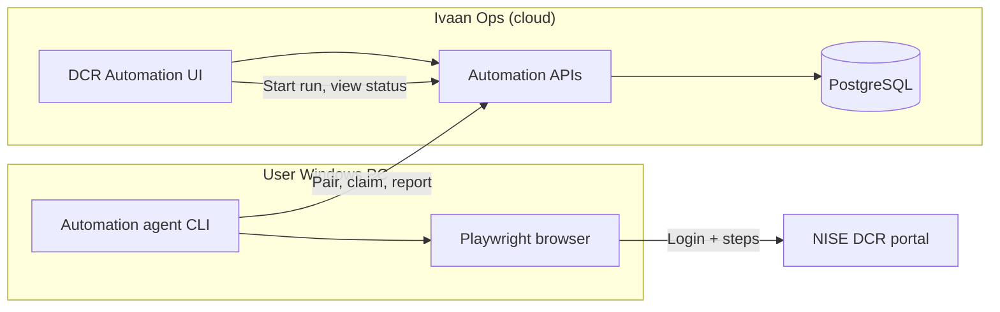
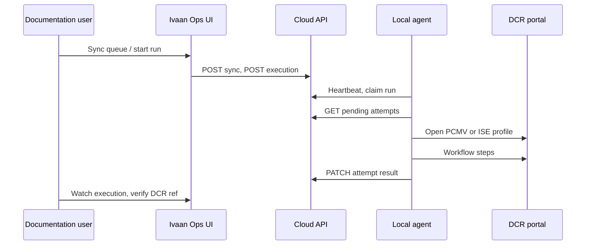

# DCR automation — architecture (plain English)

How **Share DCR to Customers** fits together: cloud app, Windows agent, and NISE portal.

**Related docs**

- [DCR-AUTOMATION-ELIGIBILITY.md](./DCR-AUTOMATION-ELIGIBILITY.md) — business rules (who gets in the queue)
- [DCR-AUTOMATION-CODE-REVIEW.md](./DCR-AUTOMATION-CODE-REVIEW.md) — simplify / review findings (fixed vs later)
- [packages/automation-agent/README.md](../packages/automation-agent/README.md) — install, pair, run on a PC

---

## What problem this solves

Your team issues **DCR certificates** on the government **NISE solar DCR portal** for eligible modules on each dispatch. **Ivaan Ops** already knows which lines qualify. This feature:

1. Builds a **queue** of eligible dispatch lines in the cloud.
2. Lets a user **start a run** from the browser.
3. Runs a **local Windows agent** that opens the portal in a real browser (Playwright) and performs steps (stub today; real flow later).
4. Stores results (DCR ref, errors, screenshots) for human verification — documentation is **not** auto-completed.

Passwords and OTP are **not** stored in the cloud. The user logs in on their PC; the agent reuses a **saved browser profile** per portal (PCMV / ISE).

---

## The three pieces

| Piece | Where it runs | Role |
|-------|----------------|------|
| **Ivaan Ops (cloud)** | Next.js + PostgreSQL | Eligibility, queue, runs, audit |
| **Automation agent** | User’s Windows PC | Playwright browser; HTTPS to cloud |
| **NISE DCR portal** | External | Actual DCR submission |

**One agent per user** (paired to their login). That agent can run work for **all companies** that user can access in Ivaan Ops.

---

## High-level diagram



---

## Happy-path sequence



---

## Two eligibility layers

```text
  DISPATCH (one documentation record)
       │
       │  Layer A: documentation eligible? → PENDING vs NOT_REQUIRED
       │
       └──► DISPATCH LINES
                 │
                 │  Layer B: automation queue eligible? (per line)
                 │
                 └──► QUEUE ROW → EXECUTION → PORTAL ATTEMPTS
```

Ivaan Ops is the **source of truth**; the portal is never used to decide who is in the queue.

---

## Dual portal (PCMV and ISE)

Same URL; different **company** on login. Default: try **PCMV**, then **ISE**. Both fail → line **`REQUIRES_MANUAL`**, doc stays **`PENDING`**.

```text
  Attempt PCMV ──fail──► Attempt ISE ──fail──► REQUIRES_MANUAL
       │
     success → store external DCR ref on queue item (human still verifies doc)
```

---

## Where the code lives (monorepo)

Everything is in **one Git repository** — the same repo as the main Ivaan Ops app.

| What | Path |
|------|------|
| **Main app (cloud)** | Repo root (`src/`, `prisma/`, …) |
| **Local agent** | `packages/automation-agent/` |
| **Windows tray app (Phase 1)** | `packages/automation-agent-desktop/` |
| npm package name | `@ivaan/automation-agent` (private, not on npm) |

There is **no separate Git repo** for the agent today. It is a **folder inside IvaanWebOps** (GitHub: `kartikeyivaan/ivaan-ops` or your fork/remote).

Root scripts:

- `npm run automation-agent:install` — `npm install` in `packages/automation-agent`
- `npm run automation-agent:build` — compile TypeScript to `packages/automation-agent/dist/`

On a PC, config after pairing: `%APPDATA%\IvaanOpsAutomation\config.json`.

---

## How other users get the agent

### Planned (non-technical staff) — see PRD

**Documentation executives should not clone Git or run npm.** That path is for developers only.

Product plan: **Windows installer** (or MSI), optional **tray app**, **Download agent** in Ivaan Ops, pairing from the browser (code or deep link). Bundled Playwright + Chromium; no separate Node install.

Full scope, phases, and estimates: **[PRD-DCR-AGENT-DESKTOP.md](./PRD-DCR-AGENT-DESKTOP.md)**.

Until that ships, use the dev path below for internal pilots only.

### Today (developers / IT pilot only)

1. Clone **IvaanWebOps** (`ivaan-ops` on GitHub).
2. Repo root: `npm run automation-agent:install`, Playwright Chromium install, `npm run automation-agent:build`.
3. Pair with 6-digit code from **DCR Automation** (see agent README).
4. Run `serve` and keep the process open during runs.

Each user pairs their own PC; device secret stays in `%APPDATA%\IvaanOpsAutomation\`.

---

## Developer file map

| Area | Location |
|------|----------|
| Eligibility | `src/lib/dcr-documentation-eligibility.ts` |
| Queue & runs | `src/lib/automation-service.ts` |
| Device pairing | `src/lib/automation-device-auth.ts` |
| Human APIs | `src/app/api/automation/**` |
| Agent APIs | `src/app/api/automation/agent/**` |
| UI | `src/components/automation/*`, `documentation/automation` |
| Agent CLI | `packages/automation-agent/src/cli.ts` |
| Desktop tray + installer | `packages/automation-agent-desktop/`, `.github/workflows/dcr-agent-desktop-release.yml` |
| Agent release API | `src/app/api/automation/agent/releases/latest/route.ts` |
| DB | `prisma/schema.prisma`, migration `20261004180000_dcr_automation_engine` |

---

## Quick start (dev)

1. `npm run db:migrate` (where needed).
2. `npm run automation-agent:install` && `npm run automation-agent:build`.
3. Pair and `serve` — see [packages/automation-agent/README.md](../packages/automation-agent/README.md).
4. Ivaan Ops → **Documentation → DCR Automation**.

---

## Glossary

| Term | Meaning |
|------|---------|
| **Execution** | One user-started run over many queue lines |
| **Queue item** | One dispatch line in the automation queue |
| **Portal attempt** | One PCMV or ISE try for one line in one execution |
| **Pairing** | Links this PC to one Ivaan Ops user (device token) |
| **Claim** | Agent asks cloud for the next run for that user |
